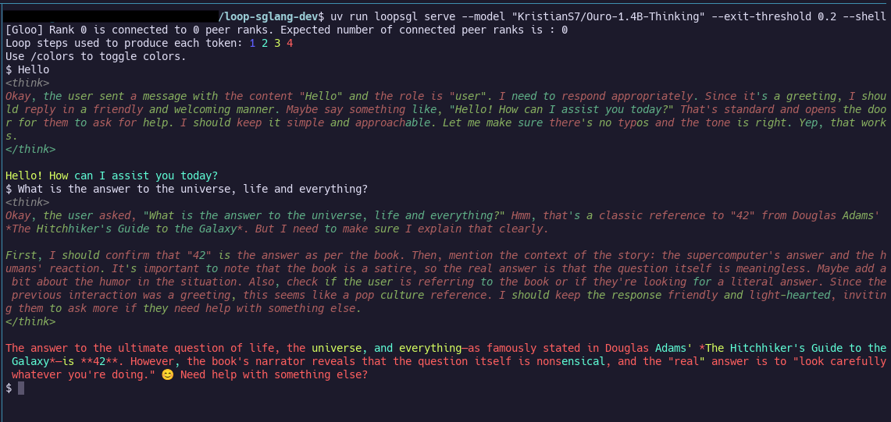

# Loop-SGLang

[](https://arxiv.org/abs/2608.09444)
[](LICENSE)

Loop-SGLang is a lightweight inference framwork for looped language models built on [Mini-SGLang](https://github.com/sgl-project/mini-sglang) and [SGLang](https://github.com/sgl-project/sglang).
It includes serveral features missing in standard inference frameworks, like efficient per-token early-exits via [Continuous Depth Batching](https://arxiv.org/abs/2608.09444) and looped KV cache sharing policies.

## Features for Looped Models

- **Efficient scheduling**: Full-depth CB and depth-adaptive CDB schedulers.
- **Supported looped models**: All four [Ouro](https://huggingface.co/collections/KristianS7/looped-lm-serving-inference) versions and [Huginn](https://huggingface.co/KristianS7/huginn-0125).
  Use our model forks for compatibility with Loop-SGLang: [forks on HF](https://huggingface.co/collections/KristianS7/looped-lm-serving-inference).
- **Looped KV caches**: Depth-indexed, last-exited, and fully shared looped KV policies.
- **Downstream task evaluation**: Clean [lm-eval](https://github.com/eleutherai/lm-evaluation-harness) integration (`loopsgl.evaluation`).
- **Runtime benchmarking**:  via `loopsgl.benchmark`.
- **CDB paper reproduction**: Scripts in `shells` folder reproduce the results of [Continuous Depth Batching paper](https://arxiv.org/abs/2608.09444).

## General Inference Features

- **Closeness to SGLang**: We keep implementations and parameter names as close as possible to SGLang for easy code entry.
- **High Performance**: Achieves state-of-the-art throughput and latency with advanced optimizations.
- **Lightweight & Readable**: A clean, modular, and fully type-annotated codebase that is easy to understand and modify.
- **Advanced Optimizations**:
  - **Radix Cache**: Reuses KV cache for shared prefixes across requests.
  - **Chunked Prefill**: Reduces peak memory usage for long-context serving.
  - **Overlap Scheduling**: Hides CPU scheduling overhead with GPU computation.
  - **Tensor Parallelism**: Scales inference across multiple GPUs.
  - **Optimized Kernels**: Integrates **FlashAttention** and **FlashInfer** for maximum efficiency.
  - **Retraction**: When KV cache is full, retract running sequences via CPU offloading or recomputation.
  - **CUDA Graphs**: Reduces kernel launch overhead during prefill and decode.
  - ...

## Quick Start

> **⚠️ Platform Support**: Loop-SGLang currently supports **Linux only** (x86_64 and aarch64). Windows and macOS are not supported due to dependencies on Linux-specific CUDA kernels (`sgl-kernel`, `flashinfer`). We recommend using [WSL2](https://learn.microsoft.com/en-us/windows/wsl/install) on Windows or Docker for cross-platform compatibility.

### 1. Environment Setup

We recommend using `uv` for a fast and reliable installation (note that `uv` does not conflict with `conda`).

```bash
# Create a virtual environment (Python 3.10+ recommended)
uv venv --python=3.12
source .venv/bin/activate
```

**Prerequisites**: Loop-SGLang relies on CUDA kernels that are JIT-compiled. Ensure you have the **NVIDIA CUDA Toolkit** installed and that its version matches your driver's version. You can check your driver's CUDA capability with `nvidia-smi`.

### 2. Installation

Install Loop-SGLang directly from source.
The Python package is `loopsgl`, and the CLI runs with `loopsgl serve`.

```bash
git clone https://github.com/kschwethelm/loop-sglang.git
cd loop-sglang && uv venv --python=3.12 && source .venv/bin/activate
uv pip install -e .
```

<details>
<summary><b>💡 Installing on Windows (WSL2)</b></summary>

Since Loop-SGLang requires Linux-specific dependencies, Windows users should use WSL2:

1. **Install WSL2** (if not already installed):
   ```powershell
   # In PowerShell (as Administrator)
   wsl --install
   ```

2. **Install CUDA on WSL2**:
   - Follow [NVIDIA's WSL2 CUDA guide](https://docs.nvidia.com/cuda/wsl-user-guide/index.html)
   - Ensure your Windows GPU drivers support WSL2

3. **Install Loop-SGLang in WSL2**:
   ```bash
   # Inside WSL2 terminal
   git clone https://github.com/kschwethelm/loop-sglang.git
   cd loop-sglang && uv venv --python=3.12 && source .venv/bin/activate
   uv pip install -e .
   ```

4. **Access from Windows**: The server will be accessible at `http://localhost:8000` from Windows browsers and applications.

</details>

<details>
<summary><b>🐳 Running with Docker</b></summary>

**Prerequisites**:
- [Docker](https://docs.docker.com/get-docker/)
- [NVIDIA Container Toolkit](https://docs.nvidia.com/datacenter/cloud-native/container-toolkit/latest/install-guide.html)

1. **Build the Docker image**:
   ```bash
   docker build -t loopsgl .
   ```

2. **Run the server**:
   ```bash
   docker run --gpus all -p 1919:1919 \
       loopsgl --model KristianS7/Ouro-1.4B --exit-threshold 0.2 --host 0.0.0.0
   ```

3. **Run in interactive shell mode**:
   ```bash
   docker run -it --gpus all \
       loopsgl --model KristianS7/Ouro-1.4B-Thinking --exit-threshold 0.2 --shell
   ```

4. **Using Docker Volumes for persistent caches** (recommended for faster subsequent startups):
   ```bash
   docker run --gpus all -p 1919:1919 \
       -v huggingface_cache:/app/.cache/huggingface \
       -v tvm_cache:/app/.cache/tvm-ffi \
       -v flashinfer_cache:/app/.cache/flashinfer \
       loopsgl --model KristianS7/Ouro-1.4B --host 0.0.0.0
   ```

</details>

### 3. Online Serving

Launch an OpenAI-compatible API server with a single command.

```bash
# Deploy Ouro or Huginn with the default depth-indexed loop cache
loopsgl serve --model "KristianS7/Ouro-1.4B"
loopsgl serve --model "KristianS7/huginn-0125"
# Deploy Ouro with early-exit and CDB
loopsgl serve --model "KristianS7/Ouro-1.4B-Thinking" --exit-threshold 0.2

# Deploy Ouro 2.6B on 2 GPUs with Tensor Parallelism, on port 30000
loopsgl serve --model "KristianS7/Ouro-2.6B-Thinking" --exit-threshold 0.2 --tp 2 --port 30000
```

Once the server is running, you can send requests using standard tools like `curl` or any OpenAI-compatible client.

### 4. Interactive Shell

Chat with your model directly in the terminal by adding the `--shell` flag.

```bash
loopsgl serve --model "KristianS7/Ouro-1.4B-Thinking" --exit-threshold 0.2 --shell
```



You can also use `/reset` to clear the chat history.
Reasoning traces are displayed in italic text and loop steps are colored.
Use `/colors` to toggle shell styling.

### 5. Accuracy Evaluation

Install the optional `eval` dependencies and run generation tasks such as GSM8K through the offline engine.
Log-likelihood and perplexity evaluation are not yet supported.

```bash
uv run --extra eval python -m loopsgl.evaluation run --model loopsgl \
    --model_args pretrained=KristianS7/Ouro-1.4B,loop_cache_policy=depth_indexed,max_gen_toks=256 \
    --tasks gsm8k_cot --num_fewshot 3 --batch_size auto
```

## 📚 Learn More

- **[Detailed Features](./docs/features.md)**: Explore all available features and command-line arguments.
- **[System Architecture](./docs/structures.md)**: Dive deep into the design and data flow of Mini-SGLang.

## Citation

If you find our code helpful, please cite our paper:

```bibtex
@misc{schwethelm2026cdb,
      title={Depth-adaptive Inference of Looped Language Models via Continuous Depth Batching},
      author={Kristian Schwethelm and Daniel Rueckert and Georgios Kaissis},
      year={2026},
      eprint={2608.09444},
      archivePrefix={arXiv},
      primaryClass={cs.LG},
      url={https://arxiv.org/abs/2608.09444},
}
```
